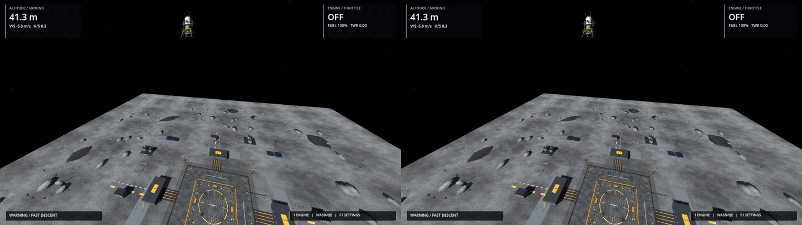
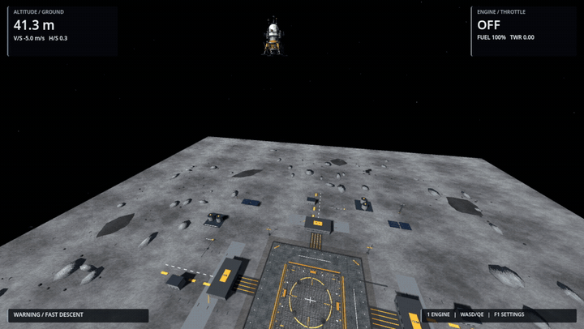

# Rocket Landing RL Simulator

A 3D lunar landing simulator for **flying by hand or training an AI**. The goal is to land safely on the platform while controlling thrust and attitude.

I built this project to learn **how reinforcement learning models learn**. The game provided an environment for experimenting with observations, actions, rewards and evaluation. I also learned development techniques and ways of working by supervising an AI model throughout development, reviewing its proposals and deciding what to keep.



## Get started

**Fly yourself:** open `project.godot` in Godot 4.7.2, wait for the initial import, and press **F5**. Use the [flight controls](#flight-controls) below.

**Train and watch an AI** (Windows):

1. Open the project in Godot once and wait for the import to finish.
2. Run `install_dependencies.bat` to create the Python environment and install dependencies.
3. Run `train.bat` to train the agent. If prompted, enter the full path to the Godot executable.
4. Run `evaluate_model.bat` to watch the saved model. Starts are randomized by default. Add `--nominal` for a centered start.

Training defaults to 100,000 SAC steps without a window. Use a terminal to pass options or read errors:

```powershell
.\train.bat --godot "C:\path\to\Godot.exe" --steps 100000 --visual
.\train.bat --help
.\evaluate_model.bat --nominal
```

Use `--output python/user_algorithms/candidate.zip` to save separately: another run using the default path replaces `python/user_algorithms/sac_rocket.zip`. Trained models are excluded from Git.

### Before and after training

| Untrained agent | Trained agent |
| --- | --- |
|  |  |

## Flight controls

| Action | Keys |
| --- | --- |
| Increase / decrease thrust | Up / Down arrow |
| Minimum / maximum thrust | `0` / `1` |
| Pitch | `W` / `S` |
| Roll | `A` / `D` |
| Yaw | `Q` / `E` |
| Pause / resume | `P` |
| Reset with randomized conditions | `R` or `N` |
| Reset to the nominal start | `Shift+R` |
| Toggle automatic controller | `T` |
| Toggle camera follow | `C` |

## Requirements and setup

- Godot **4.7.2**, with Jolt Physics and GL Compatibility.
- Python **3.10+** for AI training and evaluation.
- Windows for the included `.bat` launchers. Python commands can be adapted for other systems.
- Internet access to install Python dependencies; external visual assets are optional.

For manual Python setup on Windows:

```powershell
py -3 -m venv .venv
.\.venv\Scripts\python.exe -m pip install -e "./python[training]"
.\.venv\Scripts\python.exe python\user_algorithms\train.py --godot "C:\path\to\Godot.exe" --steps 100000
```

## Project map

| Path | Contents |
| --- | --- |
| `config/` | Physics and reward settings |
| `scenes/`, `scripts/` | Godot simulator, controls and remote bridge |
| `python/rocket_landing_env/` | TCP client and Gymnasium environment |
| `python/user_algorithms/` | Demonstrations and SAC training |
| `assets/`, `tools/` | Visual/audio assets and asset tools |
| `docs/` | Technical guide and README demonstrations |

## Troubleshooting

- **Godot not found:** pass `--godot "C:\path\to\Godot.exe"`, set `GODOT_EXE`, or add Godot to PATH.
- **Missing resources or classes:** open the project in Godot and wait for the initial import.
- **Python not found:** install Python 3.10 or newer, enable PATH access, and reopen the terminal.
- **Port already in use:** close the process using local port `55423`, or select another with `--port`.

## How it was built

- **Physics** — Godot and Jolt simulate the same lander for manual and AI flights, including lunar gravity, thrust, fuel and collisions. A landing counts after safe, stable contact with the pad.
- **Python integration** — `RocketLandingEnv` exposes Gymnasium's `reset()` and `step()` over local TCP. Godot advances one physics tick per action and returns the new state, reward and episode status.
- **Training** — Stable-Baselines3 uses Soft Actor-Critic (SAC). The agent first imitates successful demonstration flights, then improves through trial and error from varied starts.
- **Assets** — The simulator ships with procedural visuals and synthesized audio. Poly Haven textures and a NASA lunar module preview are optional downloads.

[Read the technical guide for the physics, training workflow, development notes and asset sources.](docs/technical-guide.md)
